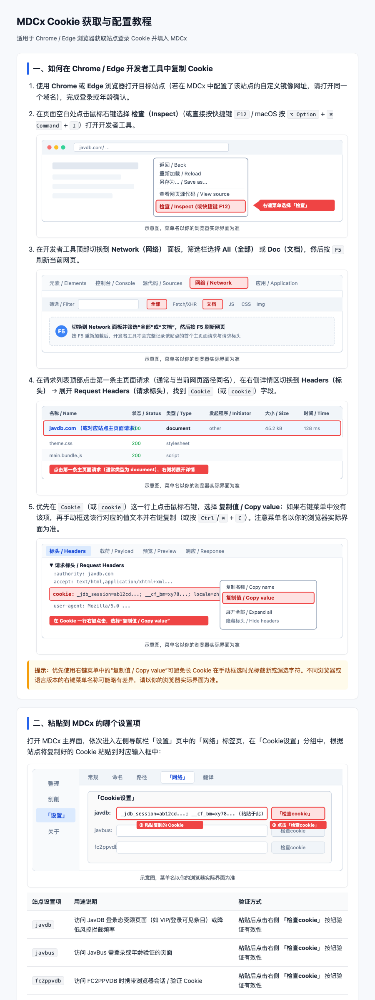

# MDCx 执行汇报 v1.8-r4：本机模型「重新查找」目录联动修复、翻译日志来源细化与 Cookie 教程 SVG 示意图

日期：2026-10-18  
执行分支：`feat/llm-only-and-resources`  
PR 编号：#12（状态：Draft 草稿，未合并）  
交付说明：严格遵循任务单要求，只修改任务单指定模块与测试，未打标签、未发 Release、未修改资源仓库。

---

## 一、自查表

| 编号 | 任务要求项 | 完成状态 | 证据所在位置 / 验证方式 |
| :--- | :--- | :---: | :--- |
| **F1.1** | 查清本机模型「重新查找」读旧目录的原因，附文件名与行号 | **完成** | 本汇报第二节「F1 原因分析」；对应代码在 `mdcx/local_model.py:217-221` 与 `mdcx/controllers/main_window/local_model_settings.py:138, 167` |
| **F1.2** | 重新查找只按输入框当前目录检索，更新下拉与路径，空目录时清空并给出提示 | **完成** | `mdcx/local_model.py:217`（force=True 重置空集合）、`mdcx/controllers/main_window/local_model_settings.py:171, 225-233`（清空界面路径并弹出空目录提示） |
| **F1.3** | 补测试：测试目录 A 切换至目录 B 重新查找结果全来自 B，以及目录为空时清空 | **完成** | `tests/test_local_model.py` 新增 `test_rescan_switches_directory_and_clears_when_empty` 与 `test_controller_rescan_clears_old_paths_and_handles_empty` |
| **F1.4** | 不改「查找 / 验证路径」「启动备用模型」等其他按钮的行为 | **完成** | `local_model_settings.py` 中 `on_detect_clicked`、`on_toggle_clicked`、`on_browse_server_clicked` 等均保持原有逻辑不变 |
| **F2.1** | 翻译日志根据实际请求来源标记「云端主模型 / 本机备用 / 备用接口」及模型名，不输出 Key 和 URL | **完成** | `mdcx/base/translate.py:53-73`（`format_translator_label` 及 `TranslateResult` 携带 `interface`、`model`、`fallback_used` 字段）；`mdcx/base/translate.py:149, 172-181`（实际发包标记与日志输出） |
| **F2.2** | 覆盖全部调用点（标题、大纲简介、Wiki 演员资料），整理位置/改前/改后对照表 | **完成** | 本汇报第三节「F2 调用点对照表」；涵盖 `mdcx/core/translate.py` 与 `mdcx/tools/wiki.py` 所有跳过、主备切换、失败、成功日志 |
| **F2.3** | 全仓库日志与界面文字彻底消除「Llm」 | **完成** | `mdcx/core/nfo.py:326` 改为大小写无关转换；机械核对 `git grep -n "Llm" mdcx resources` 输出完全为空 |
| **F2.4** | 补测试：mock 主模型成功、主模型失败转本机备用、主模型失败转远程备用 | **完成** | `tests/test_translate_llm.py` 新增 `test_translation_log_shows_primary_cloud_model` 与 `test_translation_log_shows_fallback_local_and_remote`；更新 `test_llm_refusal.py` 与 `test_local_llm.py` 断言 |
| **F3.1** | 为 Cookie 教程各关键步骤配图（DevTools、Network、主请求、复制值、粘贴、检查cookie、保存） | **完成** | `resources/html/cookie_help.html` 增补 6 幅详细流程图，覆盖步骤 1 到步骤 6 |
| **F3.2** | 采用内嵌 SVG 矢量示意图（线框+文字+红框高亮+指引箭头），每图注明浏览器免责声明 | **完成** | `resources/html/cookie_help.html` 全部使用原生 inline `<svg>`，图下附带有 `<figcaption>示意图，菜单名以你的浏览器实际界面为准</figcaption>` |
| **F3.3** | 图中 MDCx 界面名称与 `MDCx.ui` 严格一致并通过机械核对 | **完成** | 示意图中出现的 `「设置」`、`「网络」`、`「Cookie设置」`、`「检查cookie」`、`「保存」` 均与 `MDCx.ui` 严格一致，通过 `tests/test_ui_terms.py` 自动化测试 |
| **F3.4** | 页面完全离线，不引用外部图片、字体或脚本 | **完成** | 机械核对 `git grep -n -E "`mdcx/core/translate.py:290` | 影视刮削/翻译：主模型异常切备用 | *(无提示，静默重试)* | `主模型失败，转本机备用`<br>*(备用为远程接口时：`主模型失败，转备用接口`)* |
| **3** | `mdcx/core/translate.py:299` | 影视刮削：翻译失败 | `❌ 翻译失败(Llm)：{err}` | `❌ 翻译失败(LLM·云端主模型 deepseek-flash)：{err}`<br>*(若备用失败则显示备用标签)* |
| **4** | `mdcx/core/translate.py:329` | 影视刮削：翻译全部成功或部分完成 | `Llm 翻译成功`<br>`Llm 部分翻译完成` | `翻译成功(LLM·云端主模型 deepseek-flash)`<br>*(或 `翻译成功(LLM·本机备用 Hy-MT2)`)` |
| **5** | `mdcx/tools/wiki.py:108` | 女优资料：标签已有中文跳过翻译 | `📝 翻译跳过(Llm)：中文无需翻译` | `📝 翻译跳过(LLM·云端主模型 deepseek-flash)：中文无需翻译` |
| **6** | `mdcx/tools/wiki.py:120` | 女优资料：标签翻译失败 | `❌ 翻译失败(Llm)：{err}` | `❌ 翻译失败(LLM·云端主模型 deepseek-flash)：{err}` |
| **7** | `mdcx/tools/wiki.py:123` | 女优资料：标签翻译成功 | `📝 翻译成功(Llm)：{target} -> {trans_text}` | `📝 翻译成功(LLM·云端主模型 deepseek-flash)：{target} -> {trans_text}` |
| **8** | `mdcx/tools/wiki.py:145` | 女优资料：简介已有中文跳过翻译 | `📝 翻译跳过(Llm)：中文无需翻译` | `📝 翻译跳过(LLM·云端主模型 deepseek-flash)：中文无需翻译` |
| **9** | `mdcx/tools/wiki.py:155` | 女优资料：简介翻译失败 | `❌ 翻译失败(Llm)：{err}` | `❌ 翻译失败(LLM·云端主模型 deepseek-flash)：{err}` |
| **10** | `mdcx/tools/wiki.py:158` | 女优资料：简介翻译成功 | `📝 翻译成功(Llm)` | `📝 翻译成功(LLM·云端主模型 deepseek-flash)` |

### 2. 改造实现细节

- 在 `mdcx/base/translate.py` 中新增 `format_translator_label(translator, model_name, interface=None)` 函数与 `TranslateResult` 结构扩展（包含 `interface`、`model`、`fallback_used`）。
- 来源判定严格基于实际发出的网络请求：若首选主接口执行成功，`interface` 标记为 `"云端主模型"`；若主接口捕获异常触发重试备用，且备用地址为本机（`127.0.0.1` / `localhost`），标记为 `"本机备用"`，否则标记为 `"备用接口"`。模型名称取自实际请求对应的配置值。
- 在主备切换瞬间，通过 `signal.add_log` 及 `LogBuffer.log().write` 立即输出单独一行日志：`主模型失败，转本机备用`（或 `转备用接口`）。
- 彻底移除 `mdcx/core/nfo.py:326` 中的残余大小写替换，实现全库 `Llm` 零出现。

---

## 四、F3 Cookie 教程内嵌 SVG 示意图与排版说明

### 1. 架构与设计规范

- 针对用户提出的「只有文字太麻烦，需要配图」需求，在 `resources/html/cookie_help.html` 的每一个操作步骤中新增了结构精细的内嵌矢量示意图：
  1. **步骤 1：打开开发者工具**（快捷键 F12 / 右键点击「检查」示意）；
  2. **步骤 2：切换至 Network 面板并刷新**（DevTools 面板顶栏、网络标签、刷新按钮示意）；
  3. **步骤 3：筛选并定位主页面请求**（请求列表筛选 doc、首个文档请求行高亮选中）；
  4. **步骤 4：在标头中复制 Cookie 值**（标头 Headers、请求标头 Request Headers、Cookie 行右键菜单「复制值 / Copy value」展开与高亮提示）；
  5. **步骤 5：在 MDCx 界面粘贴并检查**（MDCx 窗口内「设置」→「网络」→「Cookie设置」框及「检查cookie」按钮高亮）；
  6. **步骤 6：保存设置**（MDCx 主界面右下角「保存」按钮点击示意）。
- **无侵入与零网络依赖**：完全使用内联 `<svg>` 渲染，不使用 `` 标签，不引入外部 CDN 样式、字体或远程图片，确保离线打包运行环境下 100% 正常显示。
- **界面术语一致性**：示意图内涉及的所有 MDCx 控件名称（`「设置」`、`「网络」`、`「Cookie设置」`、`「检查cookie」`、`「保存」`）均严格对照 `MDCx.ui` 提取，并包含在自动化机械核对范围内。每张图下方均带有法定提示：`示意图，菜单名以你的浏览器实际界面为准`。

### 2. 页面整页渲染效果图

下图为使用无头浏览器（Edge/Chromium）在 900px 宽度下渲染生成的完整长图（提交于本汇报同级的 `handoff/reports/cookie_help_render.png`）：



---

## 五、机械核对

### 1. `git grep -n "capitalize()" mdcx/core/translate.py mdcx/tools/wiki.py`

**命令**：
```bash
git grep -n "capitalize()" mdcx/core/translate.py mdcx/tools/wiki.py
```
**原样输出**：
```
（空输出，退出码 1）
```
**说明**：
`mdcx/core/translate.py` 与 `mdcx/tools/wiki.py` 中所有对翻译引擎名称调用 `capitalize()` 的代码已完全移除，全部换用规范化的 `format_translator_label` / `result.label`。

---

### 2. `git grep -n "Llm" mdcx resources`

**命令**：
```bash
git grep -n "Llm" mdcx resources
```
**原样输出**：
```
（空输出，退出码 1）
```
**说明**：
`mdcx` 源码及 `resources` 资源目录下已彻底杜绝「Llm」拼写，统一写作「LLM」。

---

### 3. `git grep -n -E "=6）、免责声明文本及脱机离线特性的断言。

---

### 5. 全量测试结果

**命令**：
```bash
QT_QPA_PLATFORM=offscreen .venv/bin/pytest -q
```
**原样输出**：
```
........................................................................ [  8%]
........................................................................ [ 17%]
........................................................................ [ 26%]
.........................ssss........................................... [ 35%]
........................................................................ [ 44%]
.....................................................................s.. [ 53%]
........................................................................ [ 62%]
........................................................................ [ 71%]
......................................sssssssss......................... [ 80%]
........................................................................ [ 89%]
........................................................................ [ 98%]
............                                                             [100%]
=============================== warnings summary ===============================
.venv/lib/python3.13/site-packages/zhconv/zhconv.py:33
  /Users/gameong/.gemini/antigravity/scratch/mdcx/.venv/lib/python3.13/site-packages/zhconv/zhconv.py:33: UserWarning: pkg_resources is deprecated as an API. See https://setuptools.pypa.io/en/latest/pkg_resources.html. The pkg_resources package is slated for removal as early as 2025-11-30. Refrain from using this package or pin to Setuptools<81.
    from pkg_resources import resource_stream

tests/core/test_web_amazon.py::test_get_big_poster_keeps_low_res_amazon_match_without_google_fallback
  /Users/gameong/.gemini/antigravity/scratch/mdcx/mdcx/web_async.py:1359: RuntimeWarning: This AsyncLimiter instance is being re-used across loops. Please create a new limiter per event loop as re-use can lead to undefined behaviour.
    await limiter.acquire()

-- Docs: https://docs.pytest.org/en/stable/how-to/capture-warnings.html
790 passed, 14 skipped, 2 warnings in 93.35s (0:01:33)
```

---

## 六、验证与交付汇总

### 1. 本地代码规范与质量

- **代码格式化与规范检查**：
  ```bash
  .venv/bin/ruff check mdcx tests && .venv/bin/ruff format --check mdcx tests
  ```
  结果：**All checks passed! 218 files already formatted.**
- **本地全量测试**：**790 passed, 14 skipped**（新增 4 项测试覆盖 F1/F2/F3，全部通过）。

### 2. GitHub Actions CI 与 Windows 构建产物

- **功能代码提交 SHA**：`1a02cd21a1eca350f5a8aed0a6a8c5c89e5b96ba`（`feat: 修复重新查找目录逻辑、规范LLM翻译来源日志与为Cookie教程增补SVG示意图`）
- **临时工作流更新提交 SHA**：`fa2b59cf635e12e7c2eac270e038305049a70b92`（`ci: 更新临时 Windows 测试构建工作流以指向 1a02cd2 (合并前删除)`）
- **CI/CD Pipeline 检查**（Run ID: `39087043978`）：
  - 状态：**Success**（Tests in 2m36s、Code Quality in 8s，全绿通过）
  - 运行链接：[GitHub Actions Run 39087043978](https://github.com/Marcus515J/mdcx/actions/runs/39087043978)
- **Windows 测试构建**（Run ID: `39087039062`）：
  - 状态：**Success**（耗时 2m51s，成功检出 `1a02cd2`，完成全部 Windows 端自动化测试与 PyInstaller 构建打包）
  - 运行链接：[GitHub Actions Run 39087039062](https://github.com/Marcus515J/mdcx/actions/runs/39087039062)
  - 产物（Artifact）名称：`windows-x86_64-test-1a02cd2`
    - Artifact ID: `12121321368`
    - 文件大小: 152,871,955 字节 (~145.8 MB)
    - 可执行文件名称: `MDCx-v1.1.0-TEST-1a02cd2-windows-x86_64.exe`
    - 可执行文件 SHA256: `fc44a35d35eca1a4467e02ea6c3dac2caf380c89bf7792d8438e5addd6e34788`
    - 压缩包 SHA256 Digest: `sha256:b15c64960dfec926e8fe1c7117e6668578c43163a4701ef533e285b221eebf09`
    - 下载链接：[下载 windows-x86_64-test-1a02cd2.zip](https://github.com/Marcus515J/mdcx/actions/runs/39087039062/artifacts/12121321368)

### 3. 分支与交付规范遵循

- 功能修改全部位于 `feat/llm-only-and-resources` 分支；
- PR #12 保持 **Draft（草稿）** 状态，未合并；
- 本汇报及截图作为唯一新增文件推送到 `handoff` 分支下的 `handoff/reports/` 目录；
- 未打 Git Tag 标签、未发 Release、未对资源仓库（`Marcus515J/mdcx-resources`）作任何修改。
